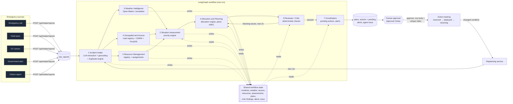
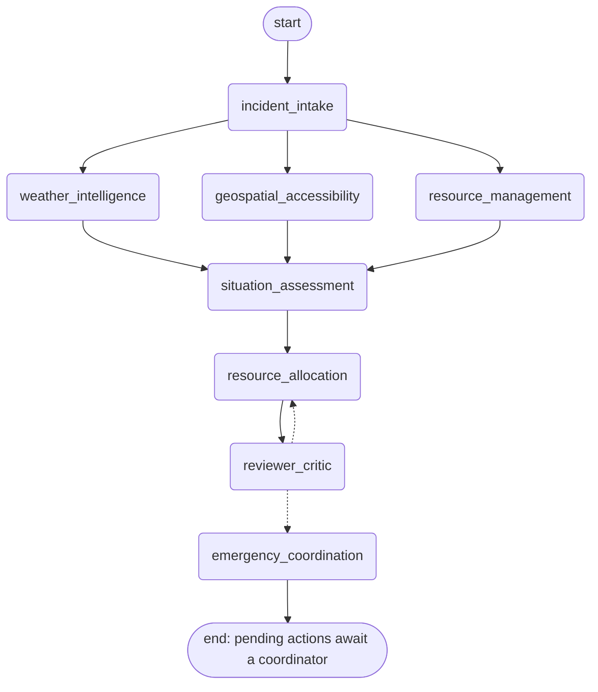
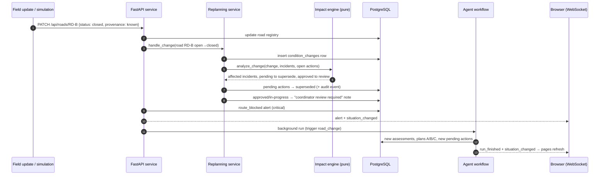
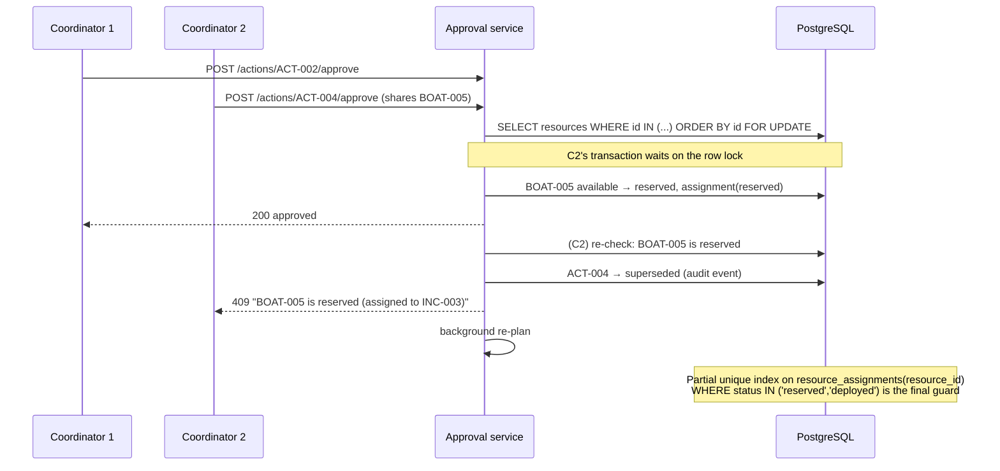
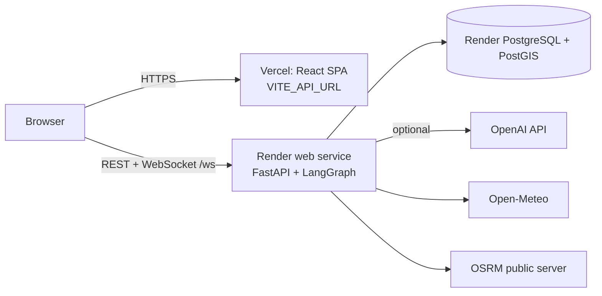

# Architecture

## 1. End-to-end chain (required flow)

Agents never call each other directly. Each one reads from and writes to the **shared workflow state**
(dashed arrows), and LangGraph decides who runs next (solid arrows). Persisted results hand off to the human
side of the system.

## 2. LangGraph graph (generated)

Generated with `python -m app.graph.workflow --mermaid docs/agent_graph.md`. The dotted edges out of
`reviewer_critic` are the conditional route: back to allocation, or on to coordination.

**Why severity runs after the fan-out:** the priority score uses weather (escalation factor), road access
(access factor) and current assignments (response gap). Running it after those three agents finish is
the simplest ordering in which every score uses this run's data.

## 3. Dynamic replanning loop

## 4. Human approval and double-allocation protection

## 5. Deployment

